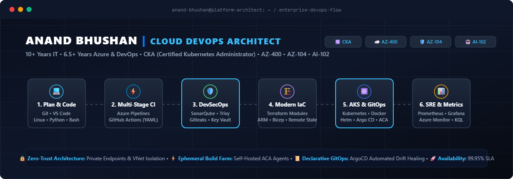

<!-- Original animated banner -->

  

<!-- Custom full-width second animation: keep the assets folder beside this README -->

  

  

  
  
  

---

### 👋 About Me

- 🚀 **10 years in IT**, including **6.5+ years focused on Azure Cloud and DevOps**
- ☁️ Design secure Azure IaaS/PaaS environments with private networking, Private Endpoints, Private DNS, and workload identity
- ⚙️ Build CI/CD platforms and containerized self-hosted agents on Azure Container Apps
- 🧱 Use Terraform to create reusable, maintainable infrastructure
- 🔐 Bring security into delivery with secret detection and container scanning
- 🌱 Exploring AIOps, Azure OpenAI workloads, and platform engineering
- 💬 Ask me about AKS, Terraform, Azure DevOps, GitHub Actions, Docker, Helm, and cloud security

  
<b>🏗️ Selected architecture highlights</b>

   

  - **Zero-trust networking:** Azure PaaS resources protected with Private Endpoints, Private DNS Zones, and VNet integration.
  - **Scalable CI/CD:** Ephemeral containerized Azure DevOps agents on Azure Container Apps, using passwordless Workload Identity Federation.
  - **Shift-left security:** Gitleaks, Trivy, and SonarQube integrated into delivery pipelines.
  - **Reusable infrastructure:** Terraform modules, remote state, environment separation, and drift detection.

---

### 🏅 Certifications

  
  
  
  
  
  

---

### 🛠️ Technology Stack

  

| Focus | Tools |
| :--- | :--- |
| **Cloud & IaC** | Azure · Terraform · AWS · GCP |
| **Containers & GitOps** | AKS · Kubernetes · Docker · Helm · Argo CD |
| **CI/CD & Security** | Azure DevOps · GitHub Actions · SonarQube · Trivy · Gitleaks |
| **Monitoring & Systems** | Prometheus · Grafana · Linux · Bash |

---

### 📊 GitHub

  
  

  

  

  

<i>Let's build, automate, and scale reliable cloud platforms. 🚀</i>

