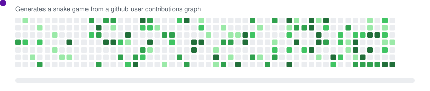
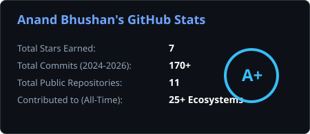
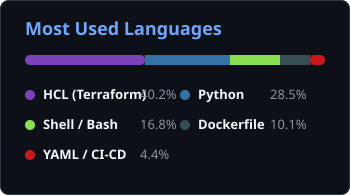

<!-- 1. Original Top Animated Banner -->

  

<!-- 4. Live Typing Animation -->

  

<!-- 5. Social Badges & Live Profile Views Counter -->

  
  
  

<!-- Animated Aqua Line Divider -->

  

<!-- 6. Original Right-Side Animated Coding GIF + About Me -->

### 👨‍💻 About Me
- 🚀 **10 years of IT experience** with **6.5+ years** specializing in **Azure Cloud, Kubernetes (AKS), Infrastructure as Code, and DevSecOps**
- 🏗️ Designing secure **Azure IaaS/PaaS** environments with **VNet Integration, Private Endpoints, Private DNS, and Workload Identity Federation**
- ⚙️ Building multi-stage CI/CD pipelines & containerized self-hosted agents on **Azure Container Apps (ACA)**
- 🌱 Exploring **AIOps, Azure OpenAI Workloads, and Platform Engineering**
- 💬 Ask me about **AKS, Terraform, Azure DevOps, GitHub Actions, Docker, Helm & Cloud Security**
- ⚡ Fun fact: **I automate everything—and keep the team laughing while deployments go green!**

<!-- Expandable Architecture Highlights -->

  
<b>🔍 Click to view my Core Enterprise DevOps Architecture Highlights</b>

   
  <ul>
    <li><b>Zero-Trust Cloud Networking:</b> Enterprise Azure PaaS resources isolated via Private Endpoints, Private DNS Zones, and VNet Integration.</li>
    <li><b>Self-Hosted CI/CD Scale:</b> Ephemeral & containerized Azure DevOps agents running on Azure Container Apps (ACA) with Workload Identity Federation (passwordless auth).</li>
    <li><b>Shift-Left DevSecOps:</b> Automated secret detection & container vulnerability scanning using Gitleaks, Trivy, and SonarQube gates.</li>
    <li><b>Modular IaC:</b> Reusable Terraform modules with remote state locking, multi-environment workspaces, and automated drift detection.</li>
  </ul>

 

  

### 🏆 Verified Certifications (Click Badges to Verify)

  
  
  
  
  
  

  

### 🛠️ Cloud, DevOps & Tech Arsenal

  

 

| Category | Technologies & Tools |
| :--- | :--- |
| **☁️ Cloud & IaC** |     |
| **🐳 Containers & GitOps** | -326CE5?style=flat-square&logo=kubernetes&logoColor=white)    |
| **🚀 CI/CD & DevSecOps** |      |
| **📈 Observability & OS** |     |

  

### 🐍 GitHub Contribution Snake Game

  <picture>
    <source media="(prefers-color-scheme: dark)" srcset="./assets/github-contribution-grid-snake-dark.svg">
    <source media="(prefers-color-scheme: light)" srcset="./assets/github-contribution-grid-snake.svg">
    
  </picture>

  

### 📊 GitHub Analytics & Performance

  
  

  

<!-- Animated Moving Water Wave Footer -->

  

