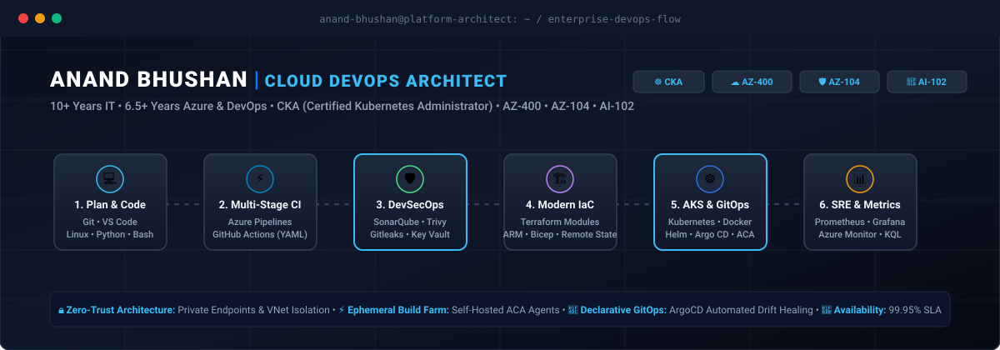

<!-- Master Hero Architecture Banner -->

  

<!-- Dynamic Typing Highlights -->

  

<!-- Connect & Status Badges -->

  
  
  

---

### 👋 About Me

- 🚀 **10 years in IT**, including **6.5+ years dedicated to Azure Cloud, Kubernetes & DevOps**
- ☁️ **Cloud & Networking**: Architect secure Azure IaaS/PaaS with Private Endpoints, Private DNS, VNet Integration, and passwordless Managed Identities
- ⚙️ **CI/CD & Ephemeral Agents**: Engineer multi-stage YAML pipelines across Azure DevOps & GitHub Actions, with auto-scaling self-hosted build agents on Azure Container Apps (ACA)
- 🧱 **Infrastructure as Code**: Author modular, reusable Terraform architectures with remote state locking, drift detection, and multi-environment consistency
- 🔐 **DevSecOps**: Enforce automated shift-left security with Trivy (container CVEs), Gitleaks (secret detection), and SonarQube (quality gates)
- ☸️ **Container Orchestration**: Production-grade Kubernetes (AKS) cluster administration, Helm chart packaging, and declarative GitOps delivery with ArgoCD
- 🌱 **AI & Observability**: Exploring Azure OpenAI workloads and full-stack observability with Azure Monitor, Prometheus, and Grafana

  
<b>🏗️ Enterprise Architecture Highlights</b>

   

  - **Zero-Trust Network Topology**: Complete isolation of PaaS data planes using Private Endpoints, eliminating public ingress across storage, databases, and microservices.
  - **Private Self-Hosted CI/CD Farm**: Scalable, ephemeral Azure DevOps agents hosted on Azure Container Apps inside isolated VNets with zero-credential Workload Identity Federation.
  - **GitOps Continuous Delivery**: Automated cluster state synchronization and drift healing using ArgoCD and parameterized Helm charts.
  - **Shift-Left Security Baseline**: Automated CVE vulnerability blocking, secret scanning, and static code quality gates baked into pull-request validation pipelines.

---

### 🏅 Verified Certifications

  
  
  
  
  
  

---

### 🚀 Featured Engineering Projects & Repositories

| Repository | Focus & Architecture | Stack |
| :--- | :--- | :--- |
| **[azure-paas-enterprise-infra](https://github.com/1-Anand/azure-paas-enterprise-infra)** | Enterprise Private Azure PaaS foundation featuring Container Apps, Function Apps, and Key Vault secured via Private Endpoints. | `Terraform` `Azure PaaS` `ACA` `VNet` |
| **[azure-terraform-resource-importer](https://github.com/1-Anand/azure-terraform-resource-importer)** | Automated discovery and import engine for unmanaged Azure resources into modular Terraform state with zero manual drifting. | `PowerShell` `Terraform` `Azure CLI` |
| **[AKS-With-ArgoCD](https://github.com/1-Anand/AKS-With-ArgoCD)** | Production Kubernetes (AKS) cluster deployment with declarative GitOps automated delivery and Helm packaging via ArgoCD. | `Kubernetes` `AKS` `ArgoCD` `Helm` |
| **[Azure-VM-StartStop-Pipelines](https://github.com/1-Anand/Azure-VM-StartStop-Pipelines)** | Automated cloud cost optimization pipeline orchestrating scheduled start/stop of Azure compute via Azure DevOps variable groups. | `Azure DevOps` `YAML` `PowerShell` |
| **[terraform-azure-landing-zone](https://github.com/1-Anand/terraform-azure-landing-zone)** | Scalable Hub-and-Spoke enterprise Azure landing zone topology with centralized firewall and subnet segmentation. | `Terraform` `HCL` `Networking` |
| **[azure-terraform-3tier-app](https://github.com/1-Anand/azure-terraform-3tier-app)** | Highly available 3-tier enterprise application architecture on Azure with VMSS, Load Balancers, and Azure SQL Database. | `Terraform` `VMSS` `Azure SQL` |

---

### 🛠️ Technology Stack

  

| Domain | Core Tools & Frameworks |
| :--- | :--- |
| **Cloud Platforms & IaC** | Microsoft Azure · Terraform · Bicep · ARM Templates · AWS · GCP |
| **Containers & Orchestration** | Kubernetes (AKS) · Docker · Helm · Argo CD (GitOps) · Azure Container Apps (ACA) |
| **CI/CD & DevSecOps** | Azure DevOps (Pipelines, Repos) · GitHub Actions · SonarQube · Trivy · Gitleaks |
| **Networking & Zero-Trust** | Virtual Networks (VNets) · Private Endpoints · Private DNS · Azure Key Vault · Managed Identities |
| **Observability & Scripting** | Prometheus · Grafana · Azure Monitor · Log Analytics (KQL) · Linux (Ubuntu/RHEL) · Bash · Python |

---

### 📊 GitHub Activity & Analytics

  
  

  

  

  

<i>Building, automating, and scaling resilient cloud platforms. 🚀</i>

